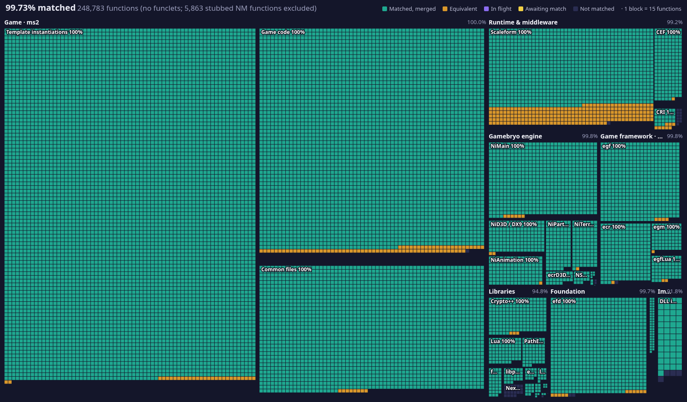

# ms2-recomp

A work-in-progress recompilation of the MapleStory2 client (KMS2 dev build, x64, April 2022).

Functions recovered from the original executable are rewritten as C++ in `src/ms2/`, one file per original
compilation unit. They are built into a proxy `dinput8.dll`. When it is placed next to the original
`MapleStory2.exe`, it uses Microsoft Detours to redirect the original functions to the recompiled ones, so every
recovered function runs inside the real game. Many functions are already a byte-for-byte match of the original,
compiled with the same compiler (MSVC 14.16).

This repository contains only the recompiled code and what is needed to build it. It does not include the game, the
Gamebryo engine source or any other SDK. You need your own copies of those.

## Progress



Each block stands for a group of functions in the original executable, grouped by subsystem. **Matched** functions
compile to the same bytes as the original. **Equivalent** ones behave the same but differ in code generation.
**Awaiting match** and **In flight** are written or in progress but not yet merged. The image is regenerated on each
publish.

Merged totals by area (functions in the original executable; regenerated on each publish together with the image):

<!-- progress:start -->
| Area | Functions | Matched | Equivalent | Done |
|---|---:|---:|---:|---:|
| Game · ms2 | 188,576 | 88,821 (47.1%) | 6,497 (3.4%) | 50.5% |
| Runtime & middleware | 20,430 | 237 (1.2%) | 14 (0.1%) | 1.2% |
| Gamebryo engine | 16,221 | 9,657 (59.5%) | 150 (0.9%) | 60.5% |
| Game framework · egf | 9,971 | 6,951 (69.7%) | 118 (1.2%) | 70.9% |
| Libraries | 8,199 | 258 (3.1%) | 4 (0.0%) | 3.2% |
| Foundation | 10,105 | 7,460 (73.8%) | 526 (5.2%) | 79.0% |
| **Total** | **253,502** | 113,384 (44.7%) | 7,309 (2.9%) | 47.6% |
<!-- progress:end -->

## Layout

| Path | Contents |
|---|---|
| `src/ms2/` | recovered game code; `client/ms2/` and `commonfiles/` follow the original source paths, `unnamed/` and `guess/` hold units whose file name is unknown or guessed, and `placeholder/` holds partially recovered class layouts |
| `src/hook/` | the hook DLL runtime (`ms2hook.h` macros, differential tests, vendored Detours) |
| `cmake/` | toolchains (clang-cl, or real cl 19.16 under Wine) and the game and engine compiler flags |
| `tools/msvc/` | wrappers that run MSVC 14.16 under Wine |
| `tools/ms2symobj.py` | turns the symbol tables into the object that binds unrecovered names to their addresses in the exe |
| `progress/symbols*.tsv` | symbol name → address tables for the original exe, used by the DLL link |
| `engine-patches/` | our Gamebryo changes as SDK-free edit scripts against stock LightSpeed 3.2.0.661 (`tools/apply-engine-patches.sh`) |
| `data/map/` | function and unit tables for the original exe (names, address ranges, unit grouping) used by the gate tools |
| `tools/progress.py`, `tools/unit-check.sh`, ... | the byte-match and functional gates; see `CONTRIBUTING.md` |

## Requirements

- Linux with CMake 3.20+, Ninja, Python 3 and Wine (the toolchains assume a Linux host)
- MSVC 14.16 (VS2017) headers, libraries and, for byte-matching builds, `cl.exe`, installed with
  [msvc-wine](https://github.com/mstorsjo/msvc-wine) into `third_party/msvc/`
- clang-cl, for the faster non-matching build
- Stock Gamebryo LightSpeed 3.2.0.661 source (not included), patched with `engine-patches/` into `engine/gamebryo/`
- DirectX SDK (June 2010) in `third_party/dxsdk/` and the NVIDIA PhysX SDK 2.8.4 in `third_party/physx284/`
- Optional: the Scaleform GFx 4.1 SDK. Without it, the build uses the placeholder types in `src/ms2/placeholder/`.
- The unpacked KMS2_DEV x64 `MapleStory2.exe` (TimeDateStamp `0x62568c46`) to run the DLL against

## Build

```sh
# clang-cl
cmake -G Ninja -S src -B build/hook-clang -DCMAKE_TOOLCHAIN_FILE=$PWD/cmake/toolchain-clangcl-x64.cmake
ninja -C build/hook-clang

# MSVC 14.16 under Wine (byte-matching flags)
cmake -G Ninja -S src -B build/hook-msvc -DCMAKE_TOOLCHAIN_FILE=$PWD/cmake/toolchain-msvc1416-wine.cmake
tools/ninja-msvc.sh -C build/hook-msvc
```

Both builds produce `dinput8.dll`. `-DMS2HOOK_WITH_GAME=OFF` builds the bare proxy with no hooks.

## Running

Copy `dinput8.dll` next to `MapleStory2.exe` and start the game (under Wine, set the DLL override `dinput8=n,b`).
The DLL writes `ms2hook.log` beside the exe, listing every hook as INSTALLED or REFUSED. Each hook checks a hash of
the original function's bytes, and the DLL refuses all hooks if the exe is not the expected build.

Environment switches: `MS2HOOK_DISABLE='*'` (or a list of names and addresses) turns hooks off,
`MS2HOOK_DIFFTEST=0` skips the differential tests, and `MS2HOOK_COUNT=0` turns off call counting.

## Contributing

See [`CONTRIBUTING.md`](CONTRIBUTING.md) for the setup, the gates a unit has to pass, and how to claim a batch of units
from the issues.

## Legal

This project is not affiliated with Nexon. MapleStory2 is a trademark of Nexon. The repository contains no game
assets, executables or engine source.
