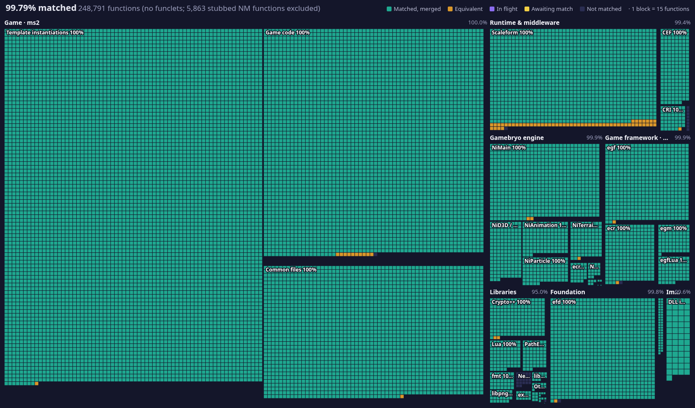

# MS2Recomp

A work-in-progress recompilation of the MapleStory2 client (KMS2 dev build, x64, April 2022).

Functions recovered from the original executable are rewritten as C++ in `src/ms2/`, one file per original
compilation unit, and compiled with the same compiler (MSVC 14.16). Most of them are a byte-for-byte match of the
original. Together with the patched Gamebryo engine and the statically linked libraries, they link into a complete
replacement `MapleStory2.exe` (the "full executable", see [`BUILDING.md`](BUILDING.md)) that boots, logs in and plays
on a server.

No function is left to write (see the table below), and `cmake/fullexe-plain` builds the full executable from this
repository and your own SDKs without the original exe ([`BUILDING.md`](BUILDING.md#without-the-original-exe)). It is
still not the same as the original. The gaps:

- The equivalent functions in the table behave the same but are not byte matches, and the exe as a whole is not
  byte-identical to the original.
- The Nexon Messenger code is stubbed out.
- The no-exe build uses stand-in resources: the exe's dev dialogs, menus, bitmaps and strings are absent, and its
  dialogs look different.
- The link still carries generated glue: the link aliases counted under the table, a zero-filled data stub and a small
  runtime shim (entry point, crash log and a few startup patches).
- Most of that glue is now derived from the checkout at configure time, but two link tables still come from a
  maintainer's build that reads the exe, so a commit that adds an engine or library unit needs a refresh first. The
  default `cmake/fullexe` build still reads the exe.
- Bugs the byte-match checks can't see still turn up (see [Recent fixes](#recent-fixes)), and not every gameplay flow
  has been tested on the full executable.
- To play you still need the game's data files and a server.

The same sources also build a proxy `dinput8.dll` that uses Microsoft Detours to redirect functions of the original
`MapleStory2.exe` to the recompiled ones. It is the development build: the per-unit gates link it, and it runs the
differential tests.

This repository contains only the recompiled code and what is needed to build it. It does not include the game, the
Gamebryo engine source or any other SDK. You need your own copies of those.

## Progress



Each block stands for a group of functions in the original executable, grouped by subsystem. **Matched** functions
compile to the same bytes as the original. **Equivalent** ones behave the same but differ in code generation;
**Compiler-limited** ones are equivalent functions whose remaining difference is compiler output that no source form
we tried reproduces (register allocation ties, link-time inlining, instruction scheduling, a different library version),
listed in `data/progress/permanent.tsv`.
**Stubbed / vendor** functions are not recovered but not missing either: the Nexon Messenger SDK code left out by design,
Microsoft library code linked unchanged, and the other "not missing" rows under the table below; the headline counts
them as done. **Awaiting match** and **In flight** are written or in progress but not yet merged. The image is
regenerated on each publish.

Merged totals by area (functions in the original executable; regenerated on each publish together with the image):

<!-- progress:start -->
| Area | Functions | Matched | Equivalent | Done |
|---|---:|---:|---:|---:|
| Game · ms2 | 176,747 | 176,595 (99.9%) | 147 (0.1%) | 100.0% |
| Runtime & middleware | 24,765 | 24,009 (96.9%) | 639 (2.6%) | 99.5% |
| Gamebryo engine | 16,881 | 16,841 (99.8%) | 27 (0.2%) | 99.9% |
| Game framework · egf | 13,111 | 13,099 (99.9%) | 11 (0.1%) | 100.0% |
| Libraries | 6,731 | 6,372 (94.7%) | 22 (0.3%) | 95.0% |
| Foundation | 13,067 | 13,063 (100.0%) | 4 (0.0%) | 100.0% |
| Imports | 782 | 780 (99.7%) | 1 (0.1%) | 99.9% |
| **Total** | **252,084** | 250,759 (99.5%) | 851 (0.3%) | 99.8% |
| *Not done, but not missing:* | | | | |
| Nexon Messenger SDK code, left out of the rebuild by design | 329 | | | |
| Microsoft library code (CRT, ATL, MFC, import thunks), linked unchanged into the rebuild | 74 | | | |
| Microsoft library code the rebuild holds once, as one identical copy shared by several | 5 | | | |
| Microsoft library code linked from another version of the same library | 1 | | | |
| Microsoft library code the original never calls, left out of the rebuild's link | 56 | | | |
| Exception-handling helpers of done functions, identical in the rebuild | 5 | | | |
| Exception filters of done functions that the rebuild's compiler folds into a constant (same behaviour) | 4 | | | |
| *Not done, still to write* | 0 | | | |

Not counted: 5,866 Nexon Messenger functions, which are stubbed out of the rebuild. The rows under the total split the 474 functions that are neither matched nor equivalent. Counting the 474 that are not missing, 100.0% is done.

Link aliases: 9 left: 0 `/alternatename` lines in `data/fullexe/plain/alias.rsp` and 9 `#pragma comment(linker, "/alternatename:...")` lines in 7 source files of the same build. The linker uses an alias to send a call that the recovered code makes under a placeholder name or signature to the real function, or to bind a placeholder data name to the real object. An alias goes away once every user takes the real declaration; the goal is 0. The glue file held 19,884 on 2026-10-31. The no-exe build no longer needs an alias file; the rest are in the sources.
<!-- progress:end -->

### Recent fixes

Since the last publish:

- The link aliases are almost gone: the no-exe build needs no alias file any more, and 9 aliases remain in the
  sources, down from 19,884 on 2026-10-31. The recovered code now names the real functions, vftables and data objects
  directly.
- The no-exe build (`cmake/fullexe-plain`) now makes most of its glue from the checkout at configure time: the list of
  game objects, the compile commands and flags, the function order and the zero-filled data stub. A commit made after
  the last glue refresh therefore builds without the exe as well (unless it adds an engine or library unit), and adding, renaming or removing a unit re-runs
  configure. Two small tables, the engine and library object picks and the init-order rules (`link.tsv`,
  `before.tsv`), still come from a maintainer's build that passed its smoke test, and are refreshed with each publish.
  See [`BUILDING.md`](BUILDING.md#glue-derived-at-configure).
- No new bugs that the byte-match checks can't see were fixed in this round; the merge was the alias removal.

Fixed in the previous publish. The byte-match checks can't see any of these bugs. None was seen in the client; the
effects come from reading the code.

- The mastery dialog's craft and magic-scroll craft boxes had their Craft and Cancel labels swapped (the buttons still
  did the right thing), and the dungeon search page showed its random and custom titles the wrong way round.
- Four formatted strings passed a value as signed where the original passes it unsigned, so a value of 2^31 or more
  would print as negative.
- With several active events giving an item trade limit, the lowest event id's limit was used instead of the highest.
- The world service's visible-object set held only scene-node pointers instead of whole records, so the background
  transparency code read past the end of each node.
- A new world-service visibility entry started in group 0 instead of -1, so removing it touched the wrong group.
- The cube map information service built and freed three maps with different allocators, and clearing one map
  destroyed its entity ids as if they were smart pointers.
- Scaleform: destroying an AS2 object's string hashes released some children a second time; an AS3 XML
  `describeType` call now does its parent-type check the way the original does; and a MovieClip frame-script call
  that names one frame three or more times fills its slots as the original does.
- CRI audio: one decoder step added in double precision instead of float, which could differ by one rounding step.

## Layout

| Path | Contents |
|---|---|
| `src/ms2/` | recovered game code; `client/ms2/` and `commonfiles/` follow the original source paths, `unnamed/` and `guess/` hold units whose file name is unknown or guessed, and `placeholder/` holds partially recovered class layouts |
| `src/ms2/scaleform/` | recovered Scaleform GFx 4.1.18 code, a git submodule ([GFx418-Recomp](https://github.com/riyukuro/GFx418-Recomp)): `git submodule update --init` |
| `src/hook/` | the hook DLL runtime (`ms2hook.h` macros, differential tests, vendored Detours) |
| `cmake/` | toolchains (clang-cl, or real cl 19.16 under Wine or natively on Windows) and the game and engine compiler flags |
| `tools/msvc/` | wrappers that run MSVC 14.16 under Wine (Linux only; on Windows the real `cl.exe` is used directly) |
| `tools/ms2paths.py` | where the tools find the exe, maps and toolchain; the Linux/Wine and native Windows differences live here |
| `.gitattributes` | turns line-ending conversion off (`* -text`): patches, maps and sources must check out byte-exact |
| `tools/ms2symobj.py` | turns the symbol tables into the object that binds unrecovered names to their addresses in the exe |
| `progress/symbols*.tsv` | symbol name → address tables for the original exe, used by the DLL link |
| `engine-patches/` | our Gamebryo changes as SDK-free edit scripts against stock LightSpeed 3.2.0.661 (`tools/apply-engine-patches.sh`) |
| `engine-patches-v2525/` | the same for the second engine tree some full-executable objects build against, applied to a separate unpatched copy |
| `data/map/` | function and unit tables for the original exe (names, address ranges, unit grouping) used by the gate tools |
| `tools/progress.py`, `tools/unit-check.sh`, ... | the byte-match and functional gates; see `CONTRIBUTING.md` |

## Requirements

- Either **Linux** with CMake 3.20+, Ninja, Python 3 and Wine, or **native Windows 10/11** with CMake 3.20+, Ninja, Python 3.10+
  and Git (no WSL, no Wine)
- MSVC 14.16 (VS2017 15.9, cl 19.16.27054) with MFC/ATL (MBCS) and the Windows 10 SDK 10.0.19041. Linux: installed with
  [msvc-wine](https://github.com/mstorsjo/msvc-wine) into `third_party/msvc/`. Windows: the Visual Studio 2017 Build Tools
  (v141 toolset); component IDs and setup in [`CONTRIBUTING.md`](CONTRIBUTING.md#windows-native-no-wsl-no-wine).
  `tools/check_toolchain.py` verifies either install against our hashes
- For byte-matching the CRI movie decoder and the GFx Video add-on, two older compilers: cl 15.00 (VS2008 SP1,
  `tools/fetch-vc9.sh`) and cl 17.00 (VS2012 Update 4, `tools/fetch-vs2012.sh`). The exe links those libraries prebuilt
  with them; the rest of Scaleform uses MSVC 14.16 like the game. The per-directory table is in the submodule's
  [`README.md`](https://github.com/riyukuro/GFx418-Recomp#compilers-by-section). clang-cl builds these units without them
- clang-cl and the LLVM tools (`llvm-nm`, `llvm-undname`), for the faster non-matching build and the gates
- Stock Gamebryo LightSpeed 3.2.0.661 source (not included), patched with `engine-patches/` into `engine/gamebryo/`
  and with `engine-patches-v2525/` into `engine/gamebryo-v2525/` (the full-executable configure does the second one;
  see [`BUILDING.md`](BUILDING.md))
- DirectX SDK (June 2010) in `third_party/dxsdk/` and the NVIDIA PhysX SDK 2.8.4 in `third_party/physx284/`
- The unpacked KMS2_DEV x64 `MapleStory2.exe` (TimeDateStamp `0x62568c46`): the default full-executable build reads it,
  and the DLL runs against it. The no-exe build (`cmake/fullexe-plain`) does not need it
- For the full executable, the other SDKs and library sources listed in [`BUILDING.md`](BUILDING.md#your-sdks)

## Build

`src/ms2/scaleform/` (the recovered Scaleform GFx 4.1.18 code) is a git submodule,
[GFx418-Recomp](https://github.com/riyukuro/GFx418-Recomp). Clone with `--recurse-submodules`, or run
`git submodule update --init` in an existing checkout (and again after a pull that moves it); CMake stops if it is missing.

### Full executable

[`BUILDING.md`](BUILDING.md) builds the replacement `MapleStory2.exe` from this checkout plus your own SDKs, with one
CMake command:

```sh
cmake --preset fullexe && cmake --build build/fullexe
```

The result is `build/fullexe/out/MapleStory2.exe` (a copy of `fullexe3.exe`, which stays next to it).

That build reads the original exe. To build without it, use `cmake/fullexe-plain` with `-DMS2_PLAIN_COMPILE=ON` (the
`windows-noexe` preset in Visual Studio; on Linux, pass the flag to CMake): see
[Without the original exe](BUILDING.md#without-the-original-exe).

### Hook DLL (development)

```sh
# clang-cl
cmake -G Ninja -S src -B build/hook-clang -DCMAKE_TOOLCHAIN_FILE=$PWD/cmake/toolchain-clangcl-x64.cmake
ninja -C build/hook-clang

# MSVC 14.16 under Wine (byte-matching flags)
cmake -G Ninja -S src -B build/hook-msvc -DCMAKE_TOOLCHAIN_FILE=$PWD/cmake/toolchain-msvc1416-wine.cmake
tools/ninja-msvc.sh -C build/hook-msvc
```

On native Windows, run the same commands from a shell that has the VS 2017 environment (`python tools\ms2paths.py shell`,
or prefix a command with `python tools\ms2paths.py run`), with the native toolchain in place of the Wine one:

```bat
cmake -G Ninja -S src -B build\hook-clang -DCMAKE_TOOLCHAIN_FILE=%CD%\cmake\toolchain-clangcl-x64.cmake
ninja -C build\hook-clang

rem MSVC 14.16 (byte-matching flags): the real cl.exe
cmake -G Ninja -S src -B build\hook-msvc -DCMAKE_TOOLCHAIN_FILE=%CD%\cmake\toolchain-msvc1416-native.cmake
ninja -C build\hook-msvc
```

The per-unit gate does these builds for you (`python tools\unit_check.py`). Both builds produce `dinput8.dll`. `-DMS2HOOK_WITH_GAME=OFF` builds the bare proxy with no hooks.

## Running

### Full executable

In a copy of the game folder, replace `x64/MapleStory2.exe` with the built `MapleStory2.exe` and remove any `dinput8.dll`, then
start the game as usual (under Wine: `wine x64/MapleStory2.exe`). The runtime shim logs fatal exceptions to
`fullexe-trap.log` beside the exe.

### Hook DLL (development)

Copy `dinput8.dll` next to `MapleStory2.exe` and start the game (on Windows nothing else is needed; under Wine, set the DLL override `dinput8=n,b`).
The DLL writes `ms2hook.log` beside the exe, listing every hook as INSTALLED or REFUSED. Each hook checks a hash of
the original function's bytes, and the DLL refuses all hooks if the exe is not the expected build.

Environment switches: `MS2HOOK_DISABLE='*'` (or a list of names and addresses) turns hooks off,
`MS2HOOK_DIFFTEST=0` skips the differential tests, and `MS2HOOK_COUNT=0` turns off call counting.

## Contributing

See [`CONTRIBUTING.md`](CONTRIBUTING.md) for the setup, the gates a unit has to pass, and how to claim a batch of units
from the issues.

## License

GNU GPL version 3 ([`LICENSE`](LICENSE)) with one additional term under section 7(b), in [`NOTICE`](NOTICE): a
distributed version, or a work based on this one, must keep the attribution "Based on MS2Recomp
(https://github.com/riyukuro/MS2Recomp)" and, if it has a user interface, show it in an About, credits or start-up
screen.

The license covers the contributors' own work here: the recompiled source, the build system, the tools and the
documentation. Third-party code keeps its own license (listed in [`NOTICE`](NOTICE)).

## Legal

This project is not affiliated with Nexon. MapleStory2 is a trademark of Nexon. The repository contains no game
assets, executables or engine source, and its license grants no rights in the game: to build and run it you need your
own copy of the game, its data files and the SDKs.
